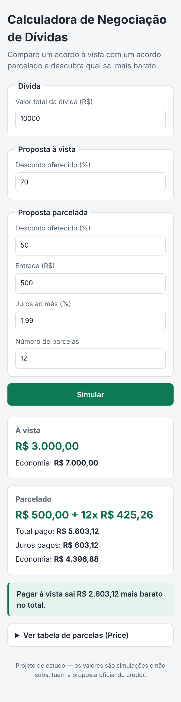

# Calculadora de Negociação de Dívidas

[](https://github.com/Guindani95/calculadora-negociacao-dividas/actions)

Compara uma proposta de acordo **à vista** com uma proposta **parcelada** e mostra qual sai mais barata no total, com a tabela de parcelas calculada pela Tabela Price.

**▶ [Abrir a calculadora](https://Guindani95.github.io/calculadora-negociacao-dividas/)**



## Por que fiz este projeto

Trabalhei como consultor financeiro com negociação de dívidas. Na hora de fechar um acordo, o cliente sempre pergunta: *"vale mais a pena pagar à vista ou parcelar?"*. Esta calculadora responde isso em segundos, mostrando os juros embutidos no parcelamento.

## Funcionalidades

- Desconto à vista e economia em relação à dívida original
- Acordo parcelado com entrada, juros mensais e número de parcelas
- Comparação automática entre as duas propostas
- Tabela de amortização mês a mês (juros, amortização e saldo)
- Layout responsivo, feito para usar no celular

## Tecnologias

- HTML, CSS e JavaScript puro (sem frameworks)
- Testes automatizados com `node:test`
- GitHub Actions para rodar os testes a cada envio
- GitHub Pages para publicar o site

## Como funciona o cálculo

A parcela segue a fórmula da Tabela Price:

```
PMT = PV × i / (1 − (1 + i)^−n)
```

`PV` = valor financiado · `i` = juros ao mês · `n` = número de parcelas

As regras de cálculo ficam em [`calculos.js`](calculos.js), separadas da tela ([`app.js`](app.js)). Assim dá para testá-las sem abrir o navegador.

## Rodando os testes

```bash
node --test
```

## Estrutura

```
├── index.html        # página
├── style.css         # visual
├── calculos.js       # regras de cálculo (testáveis)
├── app.js            # liga o formulário aos cálculos
└── calculos.test.js  # testes automatizados
```
